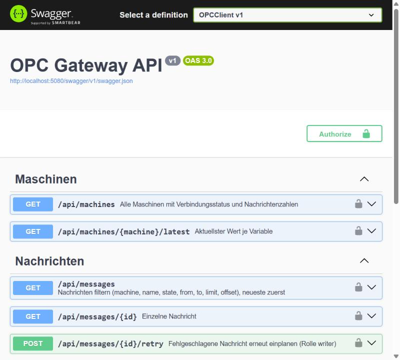
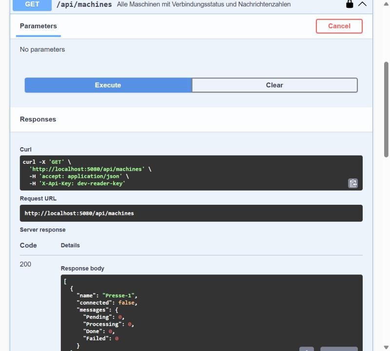
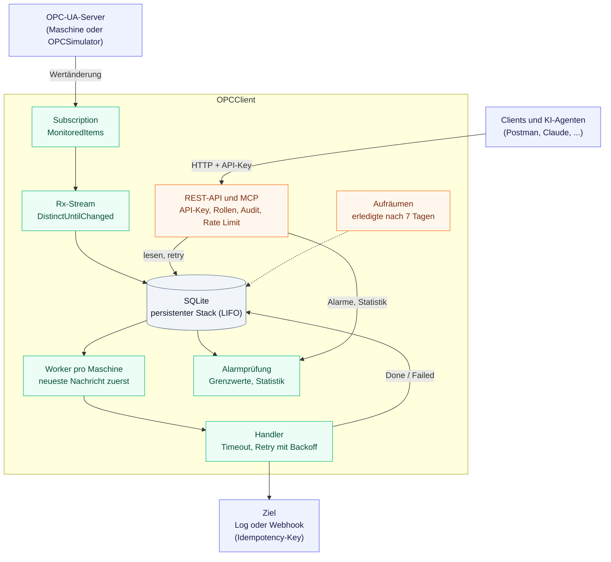

# OPCSample
[](https://github.com/vompa/OPCSample/actions/workflows/ci.yml)


OPC-UA-Client in C# (.NET 10) mit Rx.NET und persistenter LIFO-Queue (SQLite): Wertänderungen von Maschinen werden zuverlässig gespeichert, gegen Grenzwerte geprüft und mit Retry und Backoff an einen Handler (Log oder Webhook) zugestellt. Ein mitgelieferter OPC-UA-Simulator liefert zwei Maschinen, sodass alles ohne Hardware läuft.

Auf einen Blick:

- **Zuverlässig:** At-least-once-Zustellung mit stabilem `Idempotency-Key`, neustartfest, läuft auch ohne erreichbaren OPC-Server.
- **Für Agenten:** Alarme bei Grenzwertverletzung und Statistik über Zeiträume (min/max/avg, Zeitbuckets) als REST-Endpunkte und MCP-Tools.
- **Zugriff:** REST-API mit Swagger und ein MCP-Endpunkt für KI-Agenten, beide hinter API-Key mit den Rollen `reader` und `writer`, mit Rate Limit (für `/mcp` strenger) und dauerhaftem Audit-Log.
- **Ohne Hardware:** OPC-UA-Simulator (`Server/OPCSimulator`) mit `Presse-1` und `Drehbank-2`, Temperatur mit gelegentlicher Überhitzung, Drehzahl, Status und Stückzahl.
- **Getestet:** Unit-Tests ohne OPC-Server (Reihenfolge, Retry, Timeout, Shutdown, Zugriffsschutz, MCP, Alarme, Statistik, Audit, Rate Limit) und Integrationstests echter Client gegen Simulator, auch verschlüsselt (Basic256Sha256). CI mit Warnungen als Fehler.
- **Ehrlich:** Die verschlüsselte OPC-Verbindung (`UseSecurity`) ist gegen den eigenen Simulator getestet, nicht gegen eine echte Maschinensteuerung.

## Struktur

```
OPCSample/
├── Client/
│   └── OPCClient/
│       ├── Opc/        OpcMachine, OpcSessionFactory, MachineRegistry, Hosted Service, Handler, Backoff, AlarmMonitor
│       ├── Storage/    SqliteMessageStore (persistenter Stack), Alarme, Audit, Statistik, RetentionService
│       ├── Security/   API-Key-Authentifizierung (Rollen reader/writer), Audit-Log, Rate-Limit-Antwort
│       ├── Mcp/        MCP-Tools für KI-Agenten, Audit-Filter
│       ├── Api/        Minimal-API-Endpunkte
│       ├── Program.cs
│       └── appsettings.json
├── Server/
│   └── OPCSimulator/   OPC-UA-Simulationsserver (zwei Maschinen, Namespace urn:vompa:opc-simulator)
└── Tests/
    └── OPCClient.Tests/    xUnit-Tests (Unit-Tests ohne OPC-Server, Integrationstests gegen den Simulator)
```

## So sieht es aus





*Swagger-UI (nur im Development-Profil) mit dem Demo-Key des lokalen Testbetriebs. Ohne OPC-Server meldet die Maschine `connected: false`, der Dienst läuft trotzdem.*

## Starten

Voraussetzung: .NET 10 SDK. Ein externer OPC-UA-Server ist nicht nötig, der Simulator ersetzt ihn.

```
dotnet run --project Server/OPCSimulator
```

In einem zweiten Terminal den Client starten:

```
dotnet run --project Client/OPCClient
```

Der Simulator lauscht auf `opc.tcp://localhost:4840` und liefert die Knoten `ns=2;s=<Maschine>.<Variable>` (Details: [Server/OPCSimulator/README.md](Server/OPCSimulator/README.md)). Maschinen, Endpoints, Nodes und Grenzwerte (`Limits`) werden in `Client/OPCClient/appsettings.json` unter `Opc:Machines` konfiguriert; voreingestellt sind beide Simulator-Maschinen mit Temperatur 10 bis 80 °C und Drehzahl bis 1600 U/min.

Beim Start im Development-Profil sind zwei Demo-Keys konfiguriert (`appsettings.Development.json`): `dev-reader-key` (Rolle `reader`) und `dev-writer-key` (Rolle `writer`). Ohne konfigurierten Key startet der Dienst nicht.

- Swagger UI (nur Development): http://localhost:5080/swagger
- OpenAPI-JSON: http://localhost:5080/swagger/v1/swagger.json

## Ablauf

OPC-UA-Server → `MonitoredItem.Notification` → Rx-Subject (`DistinctUntilChanged`) → SQLite (Stack/LIFO) → Worker pro Maschine → Handler (mit Timeout und Retry)



- Neueste Nachricht wird zuerst verarbeitet (LIFO).
- Nach einem Absturz werden Nachrichten im Zustand "in Arbeit" wieder auf "offen" gesetzt (at-least-once, der Handler sollte idempotent sein).
- Pro Nachricht maximal 3 Versuche mit exponentiellem Backoff (1 s, 2 s, … bis 30 s, mit Jitter), danach Zustand `Failed` (per `POST /api/messages/{id}/retry` erneut einplanen).
- Erledigte Nachrichten werden nach 7 Tagen automatisch gelöscht (`Retention`), fehlgeschlagene bleiben.
- Ausgang: standardmäßig Logausgabe, optional Webhook (`Opc:Sink`) mit stabilem `Idempotency-Key`.

## API

| Methode | Pfad | Beschreibung |
|---|---|---|
| GET | `/api/health` | Lebenszeichen: `ok` oder `degraded` (anonym, ohne Details) |
| GET | `/api/machines` | Maschinen mit Verbindungsstatus und Nachrichtenzahlen |
| GET | `/api/machines/{machine}/latest` | Aktuellster Wert je Variable |
| GET | `/api/machines/{machine}/statistics` | Statistik einer Variable: name, from, to, bucketMinutes |
| GET | `/api/alarms` | Alarme: machine, name, from, to, activeOnly, limit, offset |
| GET | `/api/messages` | Filter: machine, name, state, from, to, limit, offset |
| GET | `/api/messages/{id}` | Einzelne Nachricht |
| POST | `/api/messages/{id}/retry` | Fehlgeschlagene Nachricht erneut einplanen (Rolle `writer`) |
| GET | `/api/audit` | Audit-Log: client, action, outcome, from, to, limit, offset (Rolle `writer`) |

Alle Endpunkte außer `/api/health` verlangen einen API-Key (`X-Api-Key` oder `Authorization: Bearer`), siehe [Client/OPCClient/README.md](Client/OPCClient/README.md#sicherheit). Das Wiedereinplanen (`POST …/retry`) und das Audit-Log brauchen die Rolle `writer`.

- **Alarme:** Liegt ein numerischer Wert über `High` oder unter `Low`, entsteht ein Alarm; er endet, sobald der Wert wieder im Bereich liegt. Je Variable und Art ist höchstens ein Alarm aktiv (in der Datenbank erzwungen), der Zustand übersteht Neustarts.
- **Statistik:** count, min, max, avg, erster und letzter Wert, optional in Zeitbuckets (höchstens 200, Zeitraum höchstens 31 Tage). Gespeichert werden nur Wertänderungen; die Statistik ist daher nicht zeitgewichtet.
- **Audit-Log:** Jeder MCP-Tool-Aufruf und jeder schreibende REST-Aufruf landet mit Client, Rolle, Argumenten und Ergebnis (`ok`, `denied`, `error`) in SQLite, auch abgewiesene Versuche.
- **Rate Limit:** 120 Anfragen pro Minute und Client, für `/mcp` 30; danach `429` mit `Retry-After`.

## KI-Agenten (MCP)

Unter `/mcp` steht ein [MCP](https://modelcontextprotocol.io)-Endpunkt bereit, über den KI-Agenten Maschinenstatus und Messwerte abfragen können (`list_machines`, `get_latest_values`, `query_messages`, `get_active_alarms`, `query_alarms`, `get_statistics`, `retry_message`). Es gibt bewusst kein Tool, das Werte auf der Maschine schreibt; `retry_message` ist das einzige ändernde Tool und braucht die Rolle `writer`.

```
claude mcp add --transport http opc http://localhost:5080/mcp --header "X-Api-Key: dev-reader-key"
```

## Tests

```
dotnet test OPCClient.slnx
```

Die Unit-Tests laufen ohne OPC-Server (Speicher, LIFO, Retry/Backoff, Timeout, Shutdown, Zugriffsschutz, MCP, Alarme, Statistik, Audit, Rate Limit). Die Integrationstests starten den Simulator im Prozess auf einem freien Port und verbinden einen echten Client, unverschlüsselt und mit Basic256Sha256. Die CI baut mit `TreatWarningsAsErrors` und prüft die Pakete auf bekannte Schwachstellen.

## Lizenz

[MIT](LICENSE)
